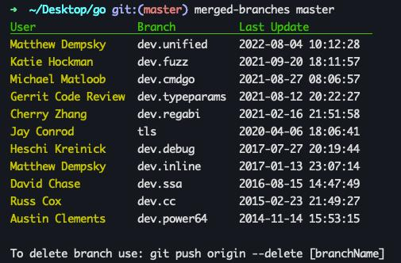

# Merged Branches

[](https://goreportcard.com/report/github.com/semiherdogan/merged-branches)
[](https://opensource.org/licenses/MIT)
[](https://pkg.go.dev/github.com/semiherdogan/merged-branches)

A command-line utility to list and manage merged Git branches with a clean, interactive interface.



## ✨ Features

- List all merged branches in a Git repository
- Filter branches by target branch
- Filter branches by author
- Interactive mode with clean table output
- Cross-platform support (macOS, Linux, Windows)
- Fast and lightweight

## 🚀 Installation

### Using Homebrew (macOS/Linux)

```bash
# Coming soon
# brew install semiherdogan/tap/merged-branches
```

### Manual Installation

1. Download the latest release for your platform from the [releases page](https://github.com/semiherdogan/merged-branches/releases)
2. Make the binary executable:
   ```bash
   chmod +x merged-branches
   ```
3. Move it to a directory in your PATH:
   ```bash
   sudo mv merged-branches /usr/local/bin/
   ```

### From Source

```bash
go install github.com/semiherdogan/merged-branches/cmd/merged-branches@latest
```

## 🛠 Usage

```bash
# Basic usage (interactive mode)
merged-branches

# Check branches merged into a specific branch
merged-branches main

# Filter by author
merged-branches main "John Doe"

# Show version
merged-branches --version

# Show help
merged-branches --help
```

### Options

- `[branch]` - Target branch to check for merged branches (default: asks interactively)
- `[user]` - Filter branches by author (optional)
- `--version, -v` - Show version information
- `--help, -h` - Show help message

## 📝 Examples

```bash
# List branches merged into main branch
merged-branches main

# List branches merged into develop by a specific author
merged-branches develop "Jane Smith"
```

## 🏗 Development

### Prerequisites

- Go 1.18 or higher
- Git

### Building from Source

```bash
git clone https://github.com/semiherdogan/merged-branches.git
cd merged-branches
go build -o merged-branches ./cmd/merged-branches
```

## 🤝 Contributing

Contributions are welcome! Please feel free to submit a Pull Request.

1. Fork the repository
2. Create your feature branch (`git checkout -b feature/amazing-feature`)
3. Commit your changes (`git commit -m 'Add some amazing feature'`)
4. Push to the branch (`git push origin feature/amazing-feature`)
5. Open a Pull Request

## 📄 License

This project is licensed under the MIT License - see the [LICENSE](LICENSE) file for details.

## 🙏 Acknowledgments

- [spinner](https://github.com/briandowns/spinner) - Terminal spinner for Go
- [table](https://github.com/rodaine/table) - A simple ASCII table formatter in Go
- [color](https://github.com/fatih/color) - Color package for Go
